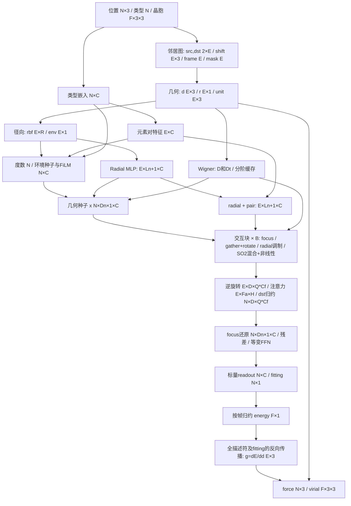

# DPA4 算子、shape 与数据流

## 范围与符号

依据本工作区 DeePMD 的 DPA4/SeZM PyTorch eager 源码整理，不以模型文件名推断结构。下面 45 项包括基础算子、复合模块和可选分支，**不是要求写 45 个独立 kernel**。复合模块应先拆出数学基线，再选融合边界。

N：批次内所有帧展平后的原子数；F：帧数；E：有向边数或填充后的容量；T：元素种类；C：主干通道；R：径向基函数数；B：交互块数；L：当前消息阶数；Ln=L+extra_node_l：节点阶数；D=(L+1)^2；Dn=(Ln+1)^2；Q：focus 数；Cf=focus_dim 或 C；M=Σ(l=0..L)[2*min(l,mmax)+1]；H：注意力 head 数。

注意力不合并 focus 时 Fa=Q、Ca=Cf；合并时 Fa=1、Ca=Q*Cf；Ch=Ca/H。G 是 S2/SO3 网格点数，必须从 quadrature/projector 读取，不能只凭 L 猜测。A 是边或节点批量轴。

主干边界为 `[N,Dn,1,C]`；边局部计算为 `[E,Q,M,Cf]`，优化实现可用 `[Q,E,M,Cf]` strided view。原源码部分 Wigner 缓存采用块打包布局；文中的 `[E,D,D]` 是数学表示，**不要求实际存稠密矩阵**。

## 完整主流程

周期约定：`edge_index[0]=src`、`edge_index[1]=dst`，行向量晶胞，`d = pos[src] + shift @ cell[edge_frame] - pos[dst]`。消息 gather **src**，聚合 **dst**。拓扑/shift 不参与梯度，d 的所有径向和旋转路径必须参与梯度。

`radial_so2_mode=none` 仍然需要**逐系数径向乘法**，不是取消径向调制；调制在 SO2 stack 之前。env_seed、sandwich_norm、S2/SO3/grid、attention、layer_scale、depth residual 等由 checkpoint 配置决定。图展示主路径，条件模块在相应阶段插入。

## 算子合同

机器可读版本：`python -m model operators`；维护源为 `python/dcu_dpa4/catalog.py`。

| 算子 | 输入 | 输出 | 计算 / 启用条件 |
|---|---|---|---|
| `linear` | `x[A,K], W[K,C], optional bias[C]` | `y[A,C]` | x@W+b; backward g@W.T and x.T@g；always |
| `rmsnorm` | `x[A,C], scale[C], eps` | `y[A,C]` | x*rsqrt(mean(x^2)+eps)*scale; scalar channel norm only；always |
| `activation` | `x[...]` | `y[...]` | configured SiLU/tanh/GELU and derivative；always |
| `segment_sum` | `x[E,K], index[E], N` | `sum[N,K]` | sum by index; backward gather upstream[index]；always |
| `inner_distance_clamp` | `distance[E,1], inner radius, sharpness` | `safe_distance[E,1]` | checkpoint-configured smooth inner-distance clamp；enabled inner-distance clamp |
| `neighbor_graph` | `r[N,3], cell[F,3,3], frame[N], rcut` | `src/dst[2,E], S[E,3], edge_frame[E], mask[E]` | periodic cell-list search; keep distances within rcut；always |
| `edge_geometry` | `r[N,3], src/dst[2,E], S[E,3], cell[F,3,3]` | `d[E,3], distance[E,1], unit[E,3]` | d=r_src+S@cell-r_dst; r=norm(d)；always |
| `edge_features` | `positions, graph, cells, mask, frequencies[1,R], cutoff/exponents/eps` | `vec[E,3], distance[E,1], unit[E,3], rbf[E,R], env[E,1]` | Fused edge geometry + Bessel/C3 features; first-order VJP; HIP implementation written but not yet compiled/validated；optional HIP path |
| `radial_basis` | `distance[E,1], frequencies[1,R], rcut, p` | `rbf[E,R], env[E,1]` | w*sinc(w*r/pi) times C3 envelope; edge envelope uses independent exponent；always |
| `type_embedding` | `atype[N], table[T+1,C]` | `type_feat[N,C]` | gather element embedding；always |
| `pair_embedding` | `type_feat[N,C], src/dst[2,E]` | `pair_feat[E,C]` | type_feat[src]+type_feat[dst]；always |
| `degree_reduce` | `env[E,1], dst[E], mask[E]` | `degree[N], inv_sqrt_degree[N,1,1]` | sum_dst(env^2), rsqrt with checkpoint-specific floor；always |
| `wigner_rotation` | `unit[E,3], L` | `D[E,D,D], Dt[E,D,D]` | edge quaternion to block-diagonal real Wigner D, D=(L+1)^2；always |
| `radial_mlp` | `rbf[E,R], linear weights` | `radial[E,L0+1,C]` | linear/norm/activation chain; use checkpoint flags；always |
| `environment_seed` | `rbf, element pair, degree, topology` | `film[N,2*C]` | environment embedding and normalized node aggregation；use_env_seed |
| `film` | `type_feat[N,C], film[N,2*C], strength` | `scalar_seed[N,C]` | x*(1+exp(a)*tanh(norm(scale)))+exp(b)*tanh(norm(shift))；use_env_seed |
| `geometric_seed` | `scalar_seed, radial[E,L0+1,C], D, topology` | `x[N,D0,1,C]` | place scalar at l=0; zonal coupling and destination scatter for l>0；always |
| `radial_fuse` | `radial[E,L0+1,C], pair_feat[E,C]` | `radial_fused[E,L0+1,C]` | broadcast-add pair features；always |
| `equivariant_norm` | `x[N,D,1,C], degree weights, scales` | `y[N,D,1,C]` | checkpoint norm balancing across irreps; not ordinary channel RMSNorm；always |
| `focus_mix` | `x[N,D,1,C], per-degree projection` | `wide[N,D,Q*Cf]` | per-degree channel projection into focus channels；always |
| `gather_rotate` | `wide[N,D,Q*Cf], src[E], D_to_m` | `local[E,Q,M,Cf]` | gather source; rotate to edge frame; select m-major reduced coefficients；always |
| `radial_modulation` | `local[E,Q,M,Cf], radial[E,L+1,C], degree_index[M], optional projection` | `local[E,Q,M,Cf]` | select radial by coefficient degree; project C to Q*Cf; multiply before SO2 stack；radial_so2_mode == none |
| `so2_linear` | `local[E,Q,M,Cf], W_m` | `local_out[E,Q,M,Cf]` | real/imaginary paired channel mixing per absolute m；always |
| `gated_activation` | `coefficients, scalar gates` | `same coefficients shape` | scalar SiLU and equivariant scalar-gated nonscalar channels；always |
| `radial_so2` | `local, radial_fused, radial kernel weights` | `local_modulated[E,Q,M,Cf]` | degree/rank/channel radial modulation；radial_so2_mode != none |
| `inverse_rotate` | `local[E,Q,M,Cf], Dt_from_m` | `message[E,D,Q*Cf]` | inverse Wigner projection into global frame；always |
| `attention_logits` | `node l=0, radial, Q/K and radial logit weights` | `logits[E,Fa,H], gate[N,Fa,H]` | QK dot product plus radial logits; checkpoint head/focus layout；H>0 |
| `attention_softmax` | `logits, env, dst, optional source gate` | `alpha[E,Fa,H]` | envelope-gated destination segment softmax WITH null mass；H>0 |
| `message_reduce` | `message, alpha or env, dst, gate` | `update[N,D,Q*Cf]` | destination scatter; output head gate and merge；always |
| `focus_unmix` | `update[N,D,Q*Cf], per-degree weights` | `update[N,D,1,C]` | project back to canonical node layout；always |
| `residual` | `x and update of matching shape` | `same shape` | x+update, optional layer scale；always |
| `degree_select` | `x[N,Dprev,1,C]` | `x[N,Dnext,1,C]` | truncate per-degree basis for a non-increasing scheduled block；l_schedule |
| `so3_linear` | `x[N,D,1,Cin], W[L+1,Cin,Cout]` | `y[N,D,1,Cout]` | same channel matrix for all m within degree l；always |
| `equivariant_ffn` | `x, SO3 linear/gates or grid projector weights` | `x_out[N,D,1,C]` | up projection; equivariant activation; down projection；always |
| `grid_project` | `coefficients[A,D,C], quadrature projection[G,D]` | `grid[A,G,C]` | linear spherical/SO3 quadrature projection; G depends on L, kmax and quadrature；S2/SO3 grid branches |
| `grid_activation` | `grid[A,G,C], scalar/grid gate, optional branch weights` | `grid_out[A,G,Cout]` | SwiGLU or polynomial grid product with scalar gating；S2/SO3 grid branches |
| `grid_integrate` | `grid[A,G,C], weighted inverse projector[D,G]` | `coefficients[A,D,C]` | quadrature-weighted inverse projection；S2/SO3 grid branches |
| `depth_attention` | `history[K,A,D,1,C], queries and normalization` | `mixed[A,D,1,C]` | depth-wise weighted residual aggregation；full/block/so2_attn_res != none |
| `cartesian_product` | `scalar/vector/rank2 features, coupling weights` | `coupled global-frame features` | Cartesian tensor product with trace/symmetric-traceless projection；edge_cartesian or node_cartesian |
| `csr_build` | `src/dst[E], N` | `rowptr[N+1], edge_permutation[E]` | count, prefix sum and reorder for segmented forward/backward；optimized gather/scatter or device scheduling |
| `scalar_readout` | `x[N,D,1,C], output FFN` | `descriptor[N,C]` | l=0 output mixing or configured grid readout；always |
| `fitting_energy` | `descriptor[N,C], fitting weights, type bias` | `atom_energy[N,1]` | fitting network plus output scale/type bias；always |
| `energy_reduce` | `atom_energy[N,1], frame[N]` | `energy[F,1]` | frame sum in energy accumulation precision；always |
| `edge_gradient` | `energy, edge-vector leaf, saved activations` | `g[E,3]` | reverse-mode derivative dE/dd; VJP of every used descriptor/fitting operator；always |
| `force_virial` | `g[E,3], d[E,3], src/dst, mask, frame` | `force[N,3], virial[F,3,3]` | F_dst+=g; F_src-=g; W_frame-=outer(g,d)；always |
| `optional_conditioning` | `charge/spin/ZBL/vacuum/depth history as configured` | `conditioned features or energy corrections` | checkpoint-specific additional paths；checkpoint flags |

## 不可省略的计算细节

- C3 envelope：u=clamp((rcut-r)/rcut,0,1)，x=1-u；p>0 时 env=u^4 Σ(k=0..p-1) C(k+3,3)x^k，p=0 时为1。Bessel=`w*sinc(w*r/pi)`，rbf与边权使用各自的 envelope 指数。r=0 必须用稳定 sinc 极限；r≥rcut 必须正确处理截断及梯度。
- 等变 RMSNorm 需要按 degree/irrep 做归一化；本项目首批 native `rmsnorm` 只实现普通最后一维归一化，不能直接替代它。
- SO2 mixer 的 ±m 是成对的实/虚分量，不能把全部 M 通道当普通线性层无差别混合。逆旋转还要保留源码的 degree rescale。
- 注意力使用 envelope/source gating，归一化分母含 null mass。普通 `softmax(logits)` 或先 softmax 再乘 env 都不是等价实现。先逐式复现 `attention.py` 再做 CSR 融合。
- S2/SO3 激活需要系数→网格、网格门控/乘积、加权逆投影；water pretrained 的 `s2_activation=[False,True]` 意味着 FFN 含网格路径。骨架把这段保留为 `equivariant_ffn` 复合占位，不声称已数值实现。
- 能量推理之外还要力：g=∂Σenergy/∂d；`F[dst]+=g; F[src]-=g; virial[frame]-=outer(g,d)`，virial 的第一轴是力分量、第二轴是位移分量。有限差分、平移/旋转等变性是最终门槛。
- mask 要作用于径向、degree、softmax、所有 scatter/VJP；即使 mask=false，native 输入索引也必须合法（不能用 -1 当 padding）。当前 primitive 接口不自动替整个模型传播 mask。

## backward/VJP 的实现任务

几何：`gd=gv+gr*u+(gu-u*dot(u,gu))/r`（r>0），位置为 src += gd、dst -= gd；cell 梯度为 `shift⊗gd`。径向：频率与距离同时求导。线性：dx=gWᵀ、dW=xᵀg。scatter：backward gather；gather：backward scatter。rotation：旋转系数和输入都求导；注意力：logits、env、source gate、value、head gate 的梯度全部保留。SO2/grid/等变 norm 与 FFN 要保存或重算反向所需状态。

首批 native geometry/radial/RMSNorm 和 fused edge-features 已写一阶 backward；linear backward 暂用 Torch GEMM、segment backward 用 gather。force/virial native 只支持推理组装，不支持 force-loss backward/二阶导。SO(2)/Wigner/grid/attention 等 reference 组合路径的梯度链已接线，但完整 checkpoint 的 E/F/V 数值对照与 DCU 验证仍未完成。

## 当前实现状态与验证顺序

当前独立目标为 `DPA4-OMol/DPA4-Neo-OMol25-100M-v20260820.pt`；不要把 water 的 `L/Q/C/R` 当作 Neo 参数。模型配置和 MegaKernel 任务边界汇总见 [`dpa4-megakernel-architecture.md`](dpa4-megakernel-architecture.md)。

- 已有 HIP primitives：geometry、Bessel+C3 radial、普通 RMSNorm、linear、segment sum、force/virial；它们仍是首批 FP32 operator，不等于全模型 native。
- 新增的独立 reference path 已接入 charge/spin、environment seed/FiLM、Wigner/GIE、SO(2) 投影/径向混合/attention 等若干 stage；代码尚未在 PyTorch checkpoint loader、完整数值 oracle 或 DCU 上执行验证。
- `DPA4Model.from_checkpoint` 仍必须报告 `complete_model=False`；当前 OMol25 活跃的 message-node SO(3) grid、SO(3)-grid FFN、readout/fitting 代码及权重映射已接线，但未经目标 checkpoint 完整加载或逐层数值验证。完整一阶 VJP 也未做 E/F/V oracle 验证。静态 task DAG 仍不是完整 persistent HIP executor；新增 opt-in worker 当前只支持被选择的 `edge_features` task（或同 payload 的线性依赖链），其他 op 会在 launch 前 fail closed。runtime status 需显式检查；该路径尚未编译/实机验证。
- 几何约定仍为 `src + shift@cell - dst`；force/virial 的符号、维度和跨帧归属应以本文件合同为准。native force/virial assembly 不可代替 `dE/dd` 的全图 VJP。

后续顺序：先在有 PyTorch/DeePMD 环境加载这份 checkpoint 并核对全部参数；完成缺失 reference stages 和 E/F/V VJP；对照同 checkpoint 的 DeePMD oracle；再把已验证热点移植到 HIP/DTK；最后验证融合、epoch 同步和 persistent scheduler。任何 DCU 精度或性能结论都需实机证据。

## 源码定位

- DeePMD `deepmd/pt/model/descriptor/sezm.py::forward_with_edges`：主描述符流程。
- `deepmd/pt_expt/utils/edge_schema.py`：src/dst、周期 shift 约定。
- `sezm_nn/edge_cache.py`、`radial.py`、`embedding.py`：缓存、径向与种子。
- `sezm_nn/block.py`、`so2.py::edge_message/forward_attention_dense`：block、调制顺序、focus/head layout。
- `sezm_nn/attention.py`、`norm.py`、`wignerd.py`、`indexing.py`：数值合同。
- `sezm_nn/ffn.py`、`grid_net.py`、`projection.py`：网格激活与 readout。
- `deepmd/pt/model/model/sezm_model.py`：能量、edge gradients 和输出组装。

以上相对路径均以相邻 `../deepmd-kit` 为根；后续上游版本变化应重新核对，而不是机械套用此表。
